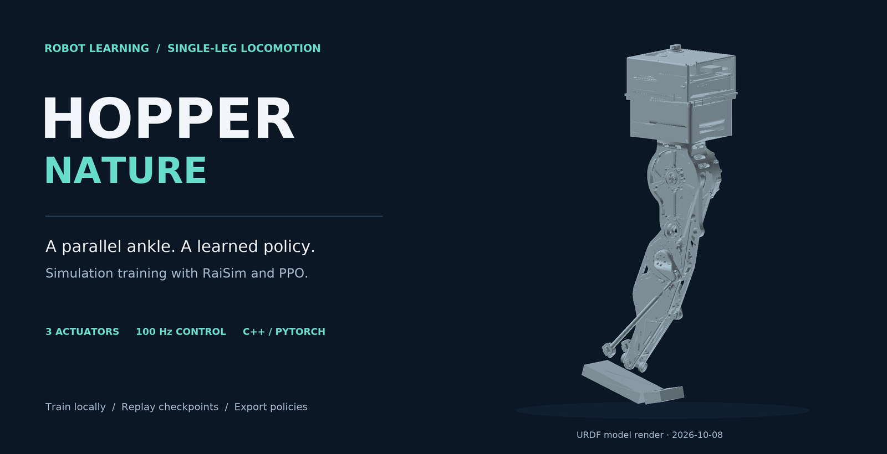
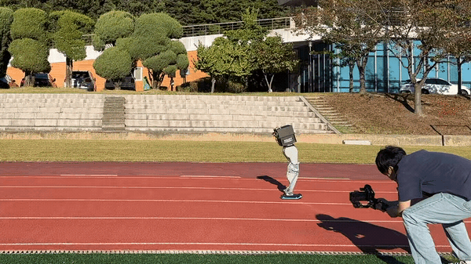
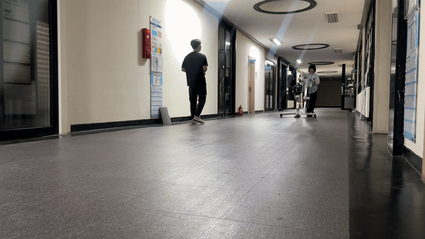

<p align="center">
  
</p>

<h1 align="center">Hopper Nature</h1>

<p align="center">
  Learning standing and hopping control for a single-leg robot with a parallel ankle.
</p>

<p align="center">
  <a href="#demos">Demos</a> ·
  <a href="#installation">Installation</a> ·
  <a href="#usage">Usage</a> ·
  <a href="docs/method.md">Method</a> ·
  <a href="docs/README.md">Documentation</a> ·
  <a href="docs/README.ko.md">한국어</a>
</p>

<p align="center">
  
  
  
  <a href="LICENSE"></a>
</p>

### Key features

- **Parallel ankle model.** Three actuators control the knee and two ankle inputs; the environment includes closed-loop ankle dynamics and kinematic initialization.
- **Learning with an estimator.** A 42-dimensional observation feeds a learned 19-dimensional state estimator and a PPO policy, with separate task and relaxed log-barrier value networks.
- **Parallel simulation.** C++ environments use OpenMP; PyTorch handles optimization on CPU or an available CUDA GPU.
- **A complete local workflow.** Train from scratch, save matching observation statistics, replay a checkpoint, and export actor/estimator parameters for downstream integration.

## Demos

<table>
  <tr>
    <th width="50%">Outdoor hopping trial</th>
    <th width="50%">Indoor hallway trial</th>
  </tr>
  <tr>
    <td align="center">
      <a href="assets/demos/outdoor-trial.mp4"></a>
    </td>
    <td align="center">
      <a href="assets/demos/indoor-trial.mp4"></a>
    </td>
  </tr>
  <tr>
    <td align="center">
      8-second excerpt · 1× playback<br>
      <a href="assets/demos/outdoor-trial.mp4">Full recording / download MP4 · 20.75 s</a>
    </td>
    <td align="center">
      Rolling test frame · 10-second excerpt · 1× playback<br>
      <a href="assets/demos/indoor-trial.mp4">Full recording / download MP4 · 42.40 s</a>
    </td>
  </tr>
</table>

The previews show recorded physical trials. Full MP4s are included in the repository; [clip intervals and recording context](docs/demos.md) describe the edits and trial conditions. The cover image is a render of the included **2026-10-08 URDF and CAD meshes**.

A full presentation will be linked here after publication on the lab's YouTube channel.

<!-- LAB_YOUTUBE_VIDEO: add the supplied public video URL here and in docs/demos.md when available. -->

## Supported setup

| Component | Reference setup |
| --- | --- |
| OS | Ubuntu 22.04, Linux x86_64 |
| Python | 3.10; the bundled pybind11 is 2.9.0 |
| Physics engine | **RaiSim 1.1.8**, installed separately with your own activation key |
| Learning | PyTorch 2.5.1; CPU works, CUDA is optional |
| Robot model | `Hop2_Parallel_Nature_20261008`, nominal total mass 17.100 kg |
| Simulation / control | 500 Hz physics / 100 Hz control |
| Visualization | Matching legacy RaiSim Unity client; optional for training |

The project source retains the [MIT license](LICENSE). **RaiSim is a separately licensed dependency**; this repository does not include an activation key. Use the pinned RaiSim 1.x dependency below; the current RaiSim 2 documentation describes a different API and viewer. [Dependency details](docs/installation.md) · [Attribution](NOTICE.md).

## Installation

The following is the CPU path. Obtain a RaiSim 1.x activation key and place it at `~/.raisim/activation.raisim` before running the simulator. See the [installation guide](docs/installation.md) for OS packages, CUDA, visualization and troubleshooting.

```bash
mkdir -p ~/hopper_ws
cd ~/hopper_ws

git clone https://github.com/raisimTech/raisimLib.git
git -C raisimLib checkout 74b836fba1dbd3227ce61f8abf7bffbd8f6e41ca
git clone --branch withDHALOneLeg https://github.com/HYUNSEOKKKKKK/Hopper_Nature.git
cd Hopper_Nature

conda create -n hopper python=3.10 pip -y
conda activate hopper
python -m pip install torch==2.5.1 --index-url https://download.pytorch.org/whl/cpu
python -m pip install -r requirements.txt

python setup.py build_ext --inplace --CMAKE_PREFIX_PATH \
  "$PWD/../raisimLib/raisim/linux;$PWD/../raisimLib/thirdParty/Eigen3"
```

Run commands below **from this repository's root**, with the same Python environment used to build the extension. No robot hardware is required.

## Usage

### 1. Check the training pipeline

```bash
python -m raisimGymTorch.env.envs.hound.runner \
  --num-envs 4 --num-threads 2 --iterations 2 \
  --headless --no-tensorboard
```

This runs two PPO updates and writes a timestamped directory under `raisimGymTorch/data/dhal_one_leg/`. The `full_0.pt` checkpoint is saved **before optimization**; it is useful for checking loading and export, and is not a trained result.

### 2. Train from scratch

```bash
python -m raisimGymTorch.env.envs.hound.runner \
  --num-envs 400 --num-threads 16 --headless --no-tensorboard

# Optional, in a second terminal:
tensorboard --logdir raisimGymTorch/data/dhal_one_leg --port 6700
```

Choose a thread count appropriate to your CPU. The research configuration defaults to 60 threads and 400 environments; CLI overrides are saved in each run's `cfg.yaml`. Training runs updates 0–10000, saving every 1000 updates. For visual training, omit `--headless` and connect the matching RaiSim Unity client. [Training options and checkpoint contents](docs/training.md).

### 3. Replay your checkpoint

```bash
python -m raisimGymTorch.env.envs.hound.tester \
  --weight /path/to/run/full_10000.pt

# Verify loading without a viewer:
python -m raisimGymTorch.env.envs.hound.tester \
  --weight /path/to/run/full_10000.pt --headless --no-realtime
```

Keep `cfg.yaml`, `mean10000.csv` and `var10000.csv` beside `full_10000.pt`. Replay uses the checkpoint's network configuration and a 22-second flat-ground command sequence alternating standing with negative body-frame x commands from −0.25 to −0.60 m/s. This sequence is an input specification; measured tracking performance requires a trained checkpoint. No pretrained result is bundled yet.

### 4. Export the policy

```bash
python scripts/export_policy.py --weight /path/to/run/full_10000.pt
```

The output directory contains `actor.txt`, `estimator.txt`, and the matching mean/variance CSV files. Export preserves the legacy text parameter layout. A downstream controller must implement the same observation, filtering, normalization, action scaling and ankle mapping. [Interface details](docs/method.md).

## Results and validation

The demos show recorded hardware trials. A selected checkpoint and quantitative evaluation will be added separately. The software checks verify local execution; they do not establish hopping success rate or tracking accuracy. The [validation record](docs/validation.md) lists the actual checks and their limits.

| Item | Source / status |
| --- | --- |
| Robot mass and calibration | 17.100 kg nominal; [measured quantities and modelling assumptions](rsc/Hop2_Parallel_Nature_20261008/README_Nature_20261008.txt) |
| Controller specification | 3 actions, 42 observations, 19 estimated states; [method](docs/method.md) |
| Local build, training, replay and export | [Validation record](docs/validation.md) |
| Recorded hardware demos | [Preview above](#demos), full MP4 and [recording context](docs/demos.md) |
| Selected trained checkpoint and quantitative evaluation | To be added with the result bundle |

<details>
<summary>Repository layout</summary>

```text
Hopper_Nature/
├── assets/                       # Model render, recorded demo previews and full MP4s
├── docs/                         # Installation, training, method and validation
├── scripts/                      # Portable export, media and release utilities
├── raisimGymTorch/
│   ├── env/envs/hound/            # Hopper environment, configuration, training/replay
│   ├── algo/ppo/                 # PPO, estimator and barrier critic
│   └── helper/                   # Configuration, logging and path helpers
├── rsc/                          # Robot model revisions and calibration records
├── kinematics_matlab/            # Mechanism analysis and kinematics scripts
└── thirdParty/pybind11/           # Vendored Python/C++ bindings
```

The historical `hound` module and `dhal_one_leg` run names are retained for compatibility. The active robot is selected in `Environment.hpp`; older robot folders are historical resources.

</details>

## Contributing and acknowledgements

Bug reports and reproducibility fixes are welcome. Include your Python, PyTorch and RaiSim versions, the command, and the full error output. See [CONTRIBUTING.md](CONTRIBUTING.md).

Built on [RaiSim / RaiSimGymTorch](https://github.com/raisimTech/raisimLib), the [HOUND environment lineage](https://github.com/GiJeongKim03/hound), [PyTorch](https://pytorch.org/), [AdamP](https://github.com/clovaai/AdamP), [Eigen](https://eigen.tuxfamily.org/) and [pybind11](https://github.com/pybind/pybind11). README organization follows [PiPER Manipulation](https://github.com/HYUNSEOKKKKKK/Piper_manipulation). Existing notices are retained; see [NOTICE.md](NOTICE.md).

For software attribution, use [CITATION.cff](CITATION.cff).
