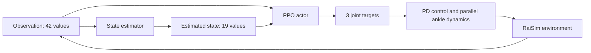

# Method and controller interface

This describes the robot, learning algorithm and controller interface implemented in this repository.

## Robot and mechanism

The active model is [Hop2_Parallel_Nature_20261008](../rsc/Hop2_Parallel_Nature_20261008/Hop2_Parallel_Nature_20261008.urdf). The system has a floating base, nine moving joint coordinates and three actuators: the knee and two ankle inputs. Passive ankle and linkage joints form the parallel ankle mechanism. `Environment.hpp` configures its constraints and solves its nominal closed-loop pose during reset.

Nominal total mass is 17.100 kg, including the 6.680 kg `Body_Nature` assembly. Some masses are measured, while COM, inertia and residual mass placement include modelling assumptions. In particular, a 0.388 kg lower-assembly residual is allocated using a prior spatial distribution. Consult the [model record](../rsc/Hop2_Parallel_Nature_20261008/README_Nature_20261008.txt) and its calibration files before treating inertial quantities as measurements.

Physics runs at 0.002 s and policy control at 0.01 s. Targets are converted to torques with PD control, mechanism geometry, torque/velocity limits and randomized actuation delay. Reset randomizes properties including mass, friction, gain, initial state and orientation bias. Curriculum changes the terrain during training.

## Learning pipeline

The actor receives normalized observation plus the estimator output, for 61 inputs. During training, the critics use observation plus the simulator's privileged state. Separate task and barrier critics support PPO updates. AdamP optimizes the actor, critics and estimator. Network hidden layers are defined in `cfg.yaml`:

| Network | Hidden layers | Input → output |
| --- | --- | --- |
| Actor | 256, 128, 64 | 61 → 3 |
| Estimator | 256, 128 | 42 → 19 |
| Task critic | 256, 128, 64 | 61 → 1 |
| Barrier critic | 256, 128, 64 | 61 → 1 |

Hidden layers use LeakyReLU. The training policy samples a diagonal Gaussian; replay uses the actor output directly.

## Observation and action

The 42 observation values are assembled in this order in `ENVIRONMENT::observe()`:

| Indices, zero-based | Values |
| --- | --- |
| 0–2 | Body orientation representation, with simulated orientation bias |
| 3–5 | Body angular velocity |
| 6–8 | Actuated joint position offsets from the nominal pose |
| 9–11 | Actuated joint velocities with signed square-root compression above magnitude 1 |
| 12–14 | Previous target offsets |
| 15–17 | Target offsets from two control steps ago |
| 18–26 | Three joint-position-error history samples |
| 27–35 | Three compressed joint-velocity history samples |
| 36–38 | Body-frame x/y velocity and yaw-rate command |
| 39–40 | Phase sine/cosine; zero in standing mode |
| 41 | Standing-mode indicator |

The first 36 values pass through a low-pass filter with alpha 0.5; command, phase and standing mode are unfiltered. The native vector environment then applies saved observation mean/variance normalization. Observation reads update the filter, so downstream controllers must match the observation call cadence.

The 19 privileged targets include body linear velocity, terrain-relative foot heights, corner/body contacts, relative foot position, ankle output positions/velocities and horizontal COM position relative to the foot. See `getState()` for exact scaling. Running statistics for privileged training state are separate from the observation CSVs.

Action scaling is `target = nominal_actuated_joint_position + 0.4 * actor_output`. Action order is knee, left ankle input, right ankle input. The nominal actuator positions are approximately `[0.4, 0.598060, 0.331160]` radians. The environment includes additional nonlinear mechanism and torque logic; these targets are not a hardware command protocol.

The variable `gait_hz_` is historically named: it is used as the **period** in `sin(phase / gait_hz_ * 2π)`. Its value 0.80 corresponds to a nominal 0.8 s phase period, not an observed 0.8 Hz hopping result.

## Rewards

Task rewards combine linear/angular velocity tracking with penalties for body orientation, joint position/velocity/acceleration, torque, foot slip/orientation, action differences, body contact, base motion and standing COM position. Relaxed log-barrier terms shape joint, height, motion, velocity, contact, clearance, impulse and smoothness constraints.

Inspect `getReward()`, `getLogBarReward()` and `isTerminalState()` in [Environment.hpp](../raisimGymTorch/env/envs/hound/Environment.hpp), and the [reward coefficients](../raisimGymTorch/env/envs/hound/cfg.yaml), for the actual implementation. Reward shaping does not establish constraint guarantees on hardware.

## Export contract

`scripts/export_policy.py` exports actor and estimator only. It transposes each 2D weight tensor before flattening and retains state dictionary order, matching the legacy text exporter. LeakyReLU behavior, layer dimensions and final linear layers must match the consuming implementation.

For replay or downstream integration, retain the exact robot model, configuration, mean/variance files, observation ordering/history, filter cadence, phase convention and action scaling from the training run. This repository does not supply the complete hardware I/O/control system used outside the simulation workflow.
